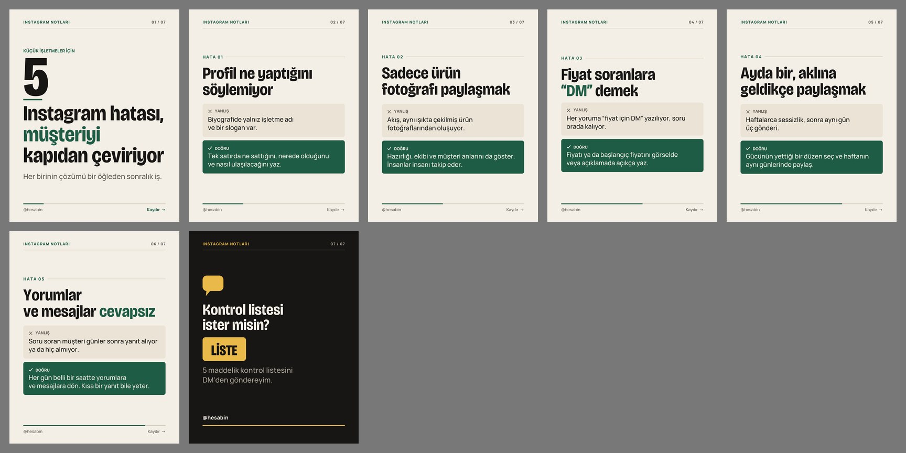
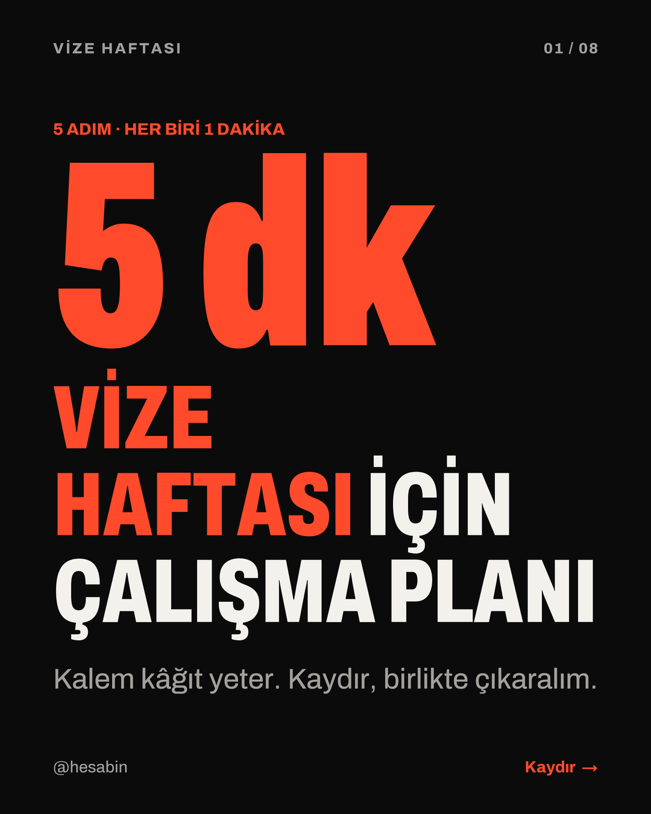
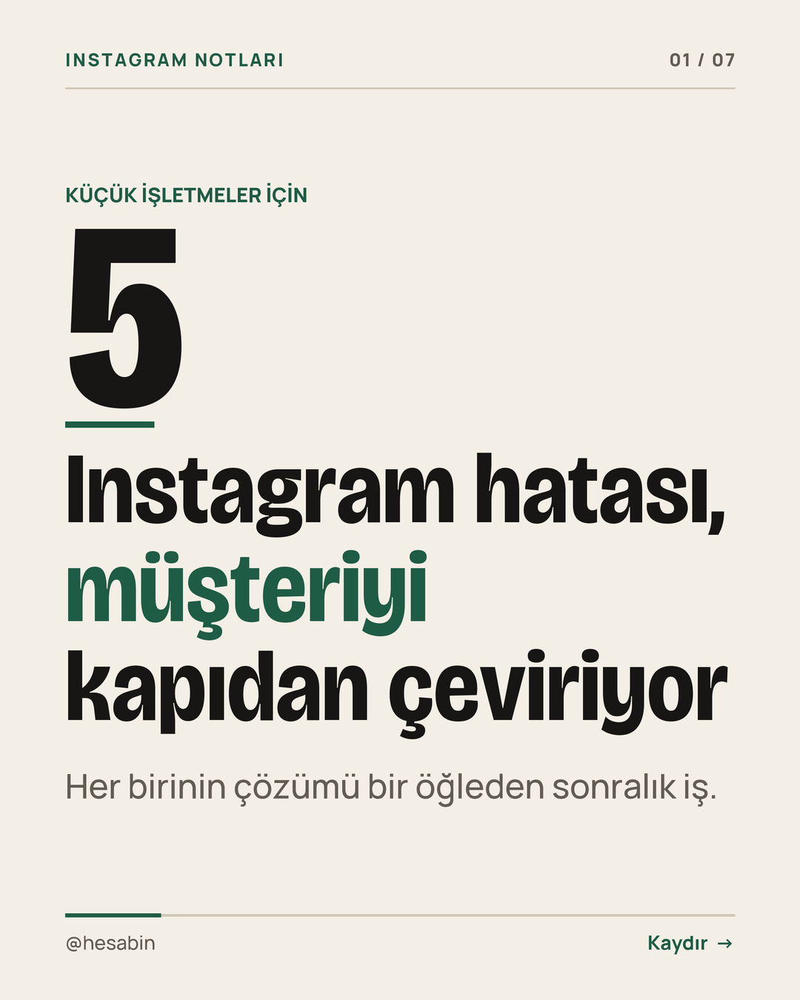
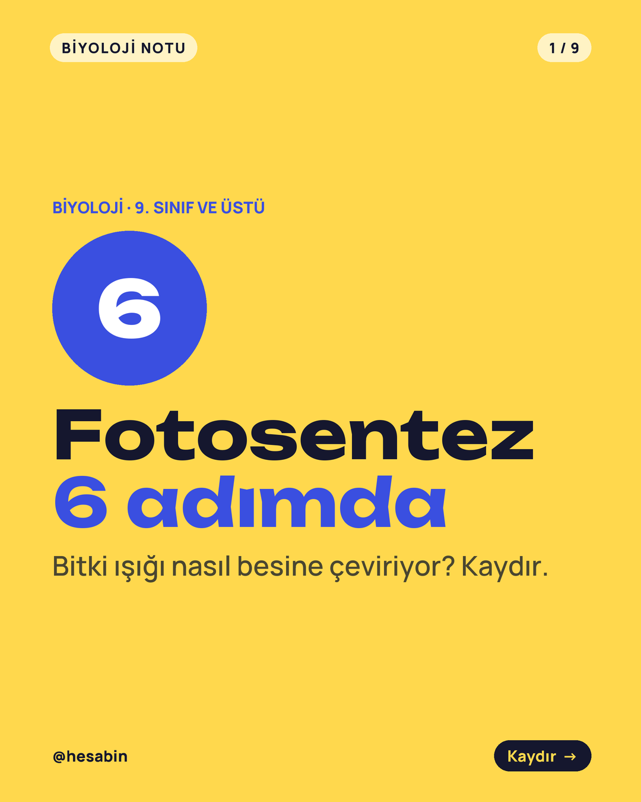

# Türkçe Carousel Üretici (Claude Code skill)

Konu ya da metin ver; Claude 5-10 slaytlık bir plan yazsın, skill de onu **1080x1350 PNG** serisine, **LinkedIn PDF**'ine
ve hazır **gönderi açıklamasına** çevirsin. Türkçe harfler bozulmadan: İSTANBUL (ISTANBUL değil), Ş/Ç çengelleri ve
İ noktaları alt satıra değmeden.

Ücretsiz, MIT lisanslı. Redirhan Studio tarafından hazırlandı. Tamamen yerel çalışır: yayın yok, hesap yok,
ücretli API yok, tarayıcı yok.



## Ne yapar?

- **Slayt planı → görsel seri.** Kanca, madde, liste, sayı, yanlış/doğru ve CTA slaytları.
- **Türkçe dizgi.** `tr_upper` ile doğru büyük harf; satır aralığı gerçek piksellere bakılarak açılır, işaretler
  çakışmaz; "ve/ile" satır sonunda, "de/da/ki/mi/için" satır başında kalmaz; sayı ile birimi ayrılmaz.
- **Ölçen kontrol.** Her slaytta taşma, kenar payı ve yazıların birbirine değmesi ölçülür; sorun varsa rapor eder.
- **Çalışan kalıplar.** Sayılı kanca, slayt başına tek fikir, özet slaytı, kaydet/paylaş ya da yorum-anahtar kelime CTA'sı.
- **Caption yazarı.** Kanca satırı + madde listesi + CTA + düz anahtar kelime satırı + en fazla 4 hashtag. Alt metinler de.
- **Reklam etiketi.** İş birliği gönderisinde her slayta "REKLAM · @marka", açıklamanın ilk satırına etiket;
  ayrıntılı denetim için ücretsiz [Reklam Etiketi Kontrolü](https://github.com/redirhan/reklam-etiketi).
- **3 ücretsiz şablon**, fontları içinde (OFL): `koyu-mercan`, `acik-editoryal`, `renkli-egitim`.

| koyu-mercan | açık-editoryal | renkli-eğitim |
|---|---|---|
|  |  |  |

## Kurulum

1. Klasörü Claude Code skill dizinine kopyala:
   ```bash
   cp -R turkce-carousel ~/.claude/skills/
   ```
2. Python ortamı (Python 3.9+):
   ```bash
   python3 -m venv ~/.venvs/turkce-carousel
   ~/.venvs/turkce-carousel/bin/pip install -r ~/.claude/skills/turkce-carousel/requirements.txt
   ```
3. Kontrol:
   ```bash
   ~/.venvs/turkce-carousel/bin/python ~/.claude/skills/turkce-carousel/scripts/carousel.py doctor
   ```

## Kullanım

Claude Code'a yazman yeterli:

> "Küçük işletmeler için 5 Instagram hatası" konusunda açık-editoryal şablonla carousel yap, sonunda yoruma LİSTE yazdır.

Claude planı yazar, çizer, her slayta bakar, gerekirse düzeltir ve dosyaları verir. Elle:

```bash
PY=~/.venvs/turkce-carousel/bin/python
S=~/.claude/skills/turkce-carousel/scripts
$PY $S/carousel.py yeni "Fotosentez 6 adımda" --sablon renkli-egitim --kalip adim > plan.yaml
# plan.yaml'ı doldur (örnekler: examples/*/plan.yaml)
$PY $S/carousel.py kontrol plan.yaml
$PY $S/carousel.py render plan.yaml --cikti carousel_cikti/
```

Çıktı klasörü: `01.png … NN.png`, `<konu>.pdf`, `caption.txt`, `alt_metin.txt`, `onizleme.jpg`, `rapor.txt`
(+ iş birliğinde `reklam_kontrol.yaml`).

## Plan dosyası

```yaml
konu: "Vize haftası için 5 dakikalık çalışma planı"
sablon: koyu-mercan
hesap: "@hesabin"
seri: "Vize haftası"
slaytlar:
  - tip: kanca
    sayi: "5 dk"
    baslik: "*Vize haftası* için çalışma planı"
    alt: "Kalem kâğıt yeter. Kaydır, birlikte çıkaralım."
  - tip: madde
    baslik: "Konuları *üçe* ayır"
    metin: "Her dersin konularını işaretle: biliyorum, yarım biliyorum, hiç bilmiyorum."
  - tip: cta
    tur: kaydet
caption:
  anahtar_kelimeler: ["vize haftası", "ders çalışma planı"]
  hashtagler: ["#vize", "#üniversite"]
```

Tüm alanlar `SKILL.md`'de. `*kelime*` vurgu rengine boyanır. Metni normal yaz; büyük harf gereken şablon Türkçe
kurala göre çevirir.

## Örnekler

| Klasör | Şablon | Kalıp |
|---|---|---|
| `examples/vize-plani/` | koyu-mercan | adım adım + özet + kaydet |
| `examples/instagram-hatalari/` | acik-editoryal | yanlış → doğru + yorum-anahtar kelime |
| `examples/fotosentez/` | renkli-egitim | adım adım + denklem özeti + paylaş |

## Sınırlar

- Fotoğraf/illüstrasyon yerleştirmez; yazı odaklı carousel üretir.
- İçeriğin doğruluğu plana bağlıdır: sayı ve istatistikleri kaynağıyla yaz.
- Paylaşmaz, DM göndermez. Yorum-anahtar kelime CTA'sı verdiysen gönderimi sen yaparsın.
- Reklam etiketi özelliği bilgilendirme amaçlıdır, hukuki görüş değildir.

## Pro şablon paketi

20 şablon (eğitim, ürün, ajans vaka, önce/sonra, alıntı, kendi marka renklerin): **yakında**.

## Lisans

Kod: MIT (`LICENSE`), © 2026 Redirhan Studio. Fontlar: SIL Open Font License 1.1 (`fonts/OFL-*.txt`) —
Archivo, Bricolage Grotesque, Manrope, Unbounded; her biri kendi yazarlarına aittir.
